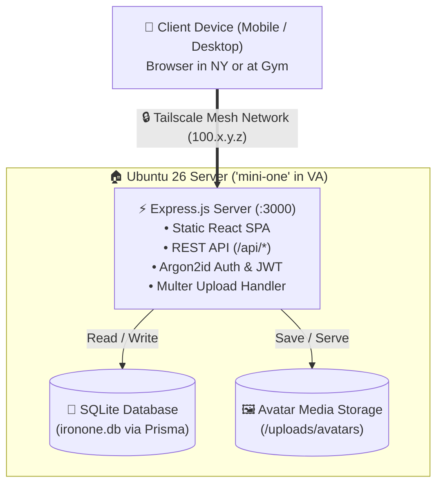
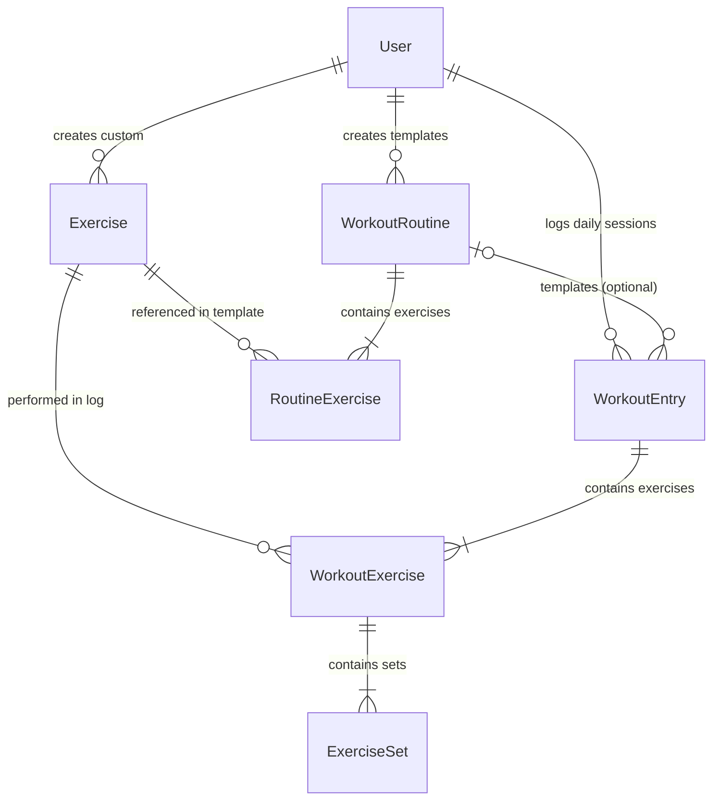

# Implementation Plan: IronOne Workout Tracker

## 1. Architecture & Tech Stack



### Proposed Stack:
- **Backend**: Node.js + Express.js (ESM).
- **Database**: **SQLite with Prisma ORM**. Runs as an isolated local file (`ironone.db`) on the Ubuntu server with zero service overhead, full relational integrity, native JSON support for multi-modal sets, and effortless snapshot backups.
- **File Uploads**: `multer` for avatar image processing (storage in `uploads/avatars/` with MIME & size validation).
- **Authentication**: **Argon2id** (`argon2` npm package) for memory-hard, GPU-resistant password hashing + `jsonwebtoken` for secure stateless API auth.
- **Frontend SPA**: React with Vite & Tailwind CSS. Designed mobile-first for frictionless gym logging, responsive for desktop review, built directly into `dist` and served statically by Express.

---

## 2. Database Schema Blueprint (Prisma / SQLite)

### Entity-Relationship (ER) Overview:


---

### Detailed Table Definitions & Functional Purpose

To avoid confusion, the database is partitioned into four distinct functional domains:
1. **User & Identity** (`User`)
2. **Master Exercise Catalog** (`Exercise`)
3. **Reusable Templates / Blueprints** (`WorkoutRoutine`, `RoutineExercise`)
4. **Daily Gym Logs / Journal** (`WorkoutEntry`, `WorkoutExercise`, `ExerciseSet`)

---

#### Domain 1: User & Identity
1. **`User`**
   - **Purpose**: Stores account authentication and profile attributes.
   - **Fields**:
     - `id`: String (UUID, Primary Key)
     - `username`: String (Unique, single string identifier)
     - `passwordHash`: String (Argon2id cryptographic hash)
     - `avatarUrl`: String (Nullable, path to uploaded PFP in `/uploads/avatars/`)
     - `height`: Float (Nullable)
     - `weight`: Float (Nullable)
     - `unitPreference`: String (`metric` or `imperial`, default `imperial`)
     - `createdAt`: DateTime
     - `updatedAt`: DateTime

---

#### Domain 2: Master Exercise Catalog
2. **`Exercise`**
   - **Purpose**: The master dictionary of physical movements ("Barbell Bench Press", "Plank", "5k Run"). It contains definitions and categories, not specific weights or dates.
   - **Fields**:
     - `id`: String (UUID, Primary Key)
     - `name`: String (e.g., "Incline Dumbbell Press")
     - `category`: String (e.g., "Chest", "Back", "Legs", "Shoulders", "Arms", "Core", "Cardio")
     - `equipment`: String (e.g., "Barbell", "Dumbbell", "Cable", "Machine", "Bodyweight", "None")
     - `modality`: String (`WEIGHT_REPS`, `TIME_DURATION`, `DISTANCE_TIME`, default `WEIGHT_REPS`)
     - `isCustom`: Boolean (default `false` for global seed movements; `true` for user-created)
     - `isArchived`: Boolean (default `false`; soft-delete so deleting a custom exercise never corrupts historical logs)
     - `userId`: Nullable Foreign Key to User (null for global library; set if created by a specific user)

---

#### Domain 3: Reusable Templates (Workout Routines)
*Analogy: A recipe in a cookbook. You read it to plan a meal, but reading it doesn't mean you ate it yet.*

3. **`WorkoutRoutine`**
   - **Purpose**: The header for a reusable workout template (e.g., "Push Day A", "Upper Hypertrophy"). It can be copied, edited, or used to start an entry.
   - **Fields**:
     - `id`: String (UUID, Primary Key)
     - `userId`: Foreign Key to User (Owner)
     - `name`: String (e.g., "Push Day A")
     - `splitTag`: String (Nullable, e.g., "Push", "Pull", "Legs", "Cardio" for visual color badges)
     - `notes`: Text (Nullable, overall instructions or focus notes)
     - `isArchived`: Boolean (default `false`; soft-delete preserves template references)
     - `createdAt`: DateTime
     - `updatedAt`: DateTime

4. **`RoutineExercise`**
   - **Purpose**: Defines which exercises belong to a `WorkoutRoutine` template and what the target goals are.
   - **Fields**:
     - `id`: String (UUID, Primary Key)
     - `routineId`: Foreign Key to WorkoutRoutine (Cascade Delete on routine deletion)
     - `exerciseId`: Foreign Key to Exercise (Restrict Delete)
     - `orderIndex`: Integer (1, 2, 3... sequence in the routine)
     - `targetSets`: Integer (e.g., 3 sets)
     - `targetValue`: String (Nullable, target guidance, e.g., "8-12 reps", "60 sec hold", "2.0 miles")
     - `targetWeight`: Float (Nullable, baseline suggested load)
     - `notes`: Text (Nullable, e.g., "Focus on 3-second eccentric pause")

---

#### Domain 4: Daily Journal & Live Gym Logs (Workout Entries)
*Analogy: The meal you actually ate today at 6:00 PM. Editing a routine never changes this past log.*

5. **`WorkoutEntry`**
   - **Purpose**: Represents an actual workout performed on a specific day/time. Multiple entries can be logged on the same calendar day (e.g., morning run + evening lift).
   - **Fields**:
     - `id`: String (UUID, Primary Key)
     - `userId`: Foreign Key to User
     - `routineId`: Nullable Foreign Key to WorkoutRoutine (`onDelete: SetNull`; preserves workout history even if a routine template is removed)
     - `name`: String (e.g., "Push Day A", "Morning 5k", or "Ad-Hoc Arm Blast")
     - `splitTag`: String (Nullable, e.g., "Push", "Cardio")
     - `status`: String (`IN_PROGRESS`, `COMPLETED`, `CANCELED`, default `IN_PROGRESS`)
     - `date`: DateTime (calendar date of workout)
     - `startedAt`: DateTime (Nullable, actual timestamp user hit "Start")
     - `completedAt`: DateTime (Nullable, timestamp user hit "Finish")
     - `durationMinutes`: Integer (Nullable)
     - `notes`: Text (Nullable, general reflections, energy levels)
     - `createdAt`: DateTime

6. **`WorkoutExercise`**
   - **Purpose**: An exercise actually performed during a specific `WorkoutEntry`. Connects the session to the master `Exercise` catalog.
   - **Why this is a separate table**: In a workout, you do multiple exercises in order. This table holds the exercise order and any exercise-specific session notes (e.g., "Swapped to dumbbells because the bench was taken").
   - **Fields**:
     - `id`: String (UUID, Primary Key)
     - `workoutEntryId`: Foreign Key to WorkoutEntry (Cascade Delete)
     - `exerciseId`: Foreign Key to Exercise (Restrict Delete)
     - `orderIndex`: Integer (display order within this session)
     - `notes`: Text (Nullable)

7. **`ExerciseSet`**
   - **Purpose**: The granular performance record for every individual set of a `WorkoutExercise`. Supports independent weight/reps per set, time holds, and cardio.
   - **Fields**:
     - `id`: String (UUID, Primary Key)
     - `workoutExerciseId`: Foreign Key to WorkoutExercise (Cascade Delete)
     - `setNumber`: Integer (1, 2, 3...)
     - `setType`: String (`WARMUP`, `NORMAL`, `DROP`, `FAILURE`, default `NORMAL`)
     - `weight`: Float (Nullable, load lifted for this set)
     - `reps`: Integer (Nullable, reps completed for this set)
     - `durationSeconds`: Integer (Nullable, duration for planks/isometric holds)
     - `distance`: Float (Nullable, distance for cardio)
     - `distanceUnit`: String (Nullable, e.g. "mi", "km", "m")
     - `rpe`: Float (Nullable, Rate of Perceived Exertion 1-10)
     - `isCompleted`: Boolean (default `false`; checked off during the workout)
     - `meta`: String / JSON (Nullable, for arbitrary variation or telemetry)

---

## 3. Step-by-Step Implementation Roadmap

### Phase 1: Project Initialization & Directory Layout
1. Initialize `package.json` with ESM module support (`"type": "module"`).
2. Configure Express server foundation with CORS, JSON parsing, and security headers (`helmet`).
3. Set up environment management via `.env` (`PORT`, `JWT_SECRET`, `DATABASE_URL`).
4. Establish directory structure:
   ```text
   IronOne/
   ├── agents/
   │   ├── REQUIREMENTS.md
   │   └── PLAN.md
   ├── server/
   │   ├── controllers/      # Auth, Workouts, Exercises, Profile
   │   ├── middleware/       # Auth verification, upload handler, error handler
   │   ├── models/ or prisma/# Database client and schemas
   │   ├── routes/           # API route definitions
   │   ├── seeds/            # Initial master exercise catalog seed
   │   └── server.js         # Main Express entry point
   ├── client/               # SPA Frontend (React + Vite + Tailwind)
   │   ├── src/
   │   │   ├── components/   # WorkoutCard, ExercisePicker, SetRow, etc.
   │   │   ├── pages/        # Login, Register, Dashboard, ActiveWorkout, Profile
   │   │   ├── api/          # Axios/Fetch client
   │   │   └── App.jsx
   │   └── index.html
   ├── uploads/              # Profile pictures and user uploads
   ├── package.json
   └── README.md
   ```

### Phase 2: Database Layer & Master Exercise Seeding
1. Set up database client (Prisma ORM with SQLite).
2. Configure SQLite with **Write-Ahead Logging (WAL)** mode (`PRAGMA journal_mode = WAL;`) for non-blocking concurrent reads and writes.
3. Run database migration to generate the tables (`User`, `Exercise`, `WorkoutRoutine`, `RoutineExercise`, `WorkoutEntry`, `WorkoutExercise`, `ExerciseSet`).
4. Create a seed script (`seed.js`) containing a curated library of standard bodybuilding, powerlifting, calisthenics, and cardio exercises categorized by muscle groups and modality.

### Phase 3: User Authentication & Profile Service
1. **Registration & Password Hashing**:
   - Implement `POST /api/auth/register` (validates username, hashes password using **Argon2id**, creates user record).
2. **Login & JWT Issuance**:
   - Implement `POST /api/auth/login` (verifies credentials against Argon2id hash, generates signed JWT).
3. **Protected Auth Middleware**:
   - Implement `authenticateToken` middleware to safeguard user-specific endpoints.
4. **Profile Management**:
   - `GET /api/user/profile` - Fetch current user info.
   - `PUT /api/user/profile` - Update username, weight, height, unit preference.
   - `POST /api/user/avatar` - Handle avatar image upload via `multer`, resize/sanitize if needed, save to `uploads/avatars/`, and update user record.

### Phase 4: Exercise Catalog Endpoints
1. `GET /api/exercises` - Retrieve master exercise catalog + user's custom exercises, searchable by name, muscle group, and modality.
2. `POST /api/exercises` - Add a new custom exercise for the current user.
3. `DELETE /api/exercises/:id` - Soft-delete a custom exercise (`isArchived = true`) to protect historical logs.

### Phase 5: Workout Engine (Routines & Journal Entries API)
1. **Workout Routines (Templates)**:
   - `GET /api/routines` - List user's saved routines.
   - `GET /api/routines/:id` - Get routine template details with exercises.
   - `POST /api/routines` - Create a new workout routine template.
   - `PUT /api/routines/:id` - Update routine name, exercises, target sets/reps.
   - `POST /api/routines/:id/copy` - Duplicate an existing routine to easily build split variations.
   - `POST /api/routines/:id/start` - Instantiate a new active `WorkoutEntry` from this routine template.
   - `DELETE /api/routines/:id` - Soft-delete or archive a routine template.
2. **Workout Entries (Daily Journal Logs)**:
   - **Single Active Workout Rule**: Enforce that a user only has one `IN_PROGRESS` entry at any given moment. If an active session exists, `POST /api/workout-entries` returns the active workout ID so the frontend can prompt to resume or finish it.
   - `GET /api/workout-entries` - Chronological journal of logged workouts (supports multiple entries per day) with pagination and date filters.
   - `GET /api/workout-entries/calendar` - Aggregate daily workout badges and entry counts for calendar view.
   - `GET /api/workout-entries/active` - Fetch current active `in_progress` workout entry if one exists.
   - `POST /api/workout-entries` - Start a spontaneous ad-hoc entry from scratch (no routine required).
   - `GET /api/workout-entries/:id` - Get full details of an entry with exercises and sets.
   - `PUT /api/workout-entries/:id` - Update entry metadata (title, date, notes).
   - `POST /api/workout-entries/:id/complete` - Finish active workout, set completion timestamp, calculate duration.
   - `POST /api/workout-entries/:id/clone` - Duplicate a past workout into today's session, carrying over past weights and reps as uncompleted baseline targets (`isCompleted = false`) for progressive overload.
   - `DELETE /api/workout-entries/:id` - Delete a workout entry.
3. **Individual Exercise & Multi-Modal Set Updates**:
   - `POST /api/workout-entries/:id/exercises` - Add an exercise to an active entry.
   - `PUT /api/workout-exercises/:id` - Update exercise notes/order.
   - `DELETE /api/workout-exercises/:id` - Remove an exercise from an entry.
   - `POST /api/workout-exercises/:id/sets` - Add a set (weights/reps, time duration, or distance).
   - `PUT /api/sets/:id` - Update set metrics (varying weights/reps, duration, distance, RPE, completion status).
   - `DELETE /api/sets/:id` - Remove a set.
4. **Exercise Swapping Feature**:
   - `POST /api/workout-exercises/:id/swap` - Swap out exercise `A` with exercise `B` on the fly within an active entry, choosing to keep or reset sets.

### Phase 6: Mobile-First, Frictionless SPA Frontend
1. **Authentication Flow**:
   - Clean, lightweight Login & Register screens with auto-login on token storage.
2. **Routines Management**:
   - Routine list with "Start Workout" and "Copy Routine" quick actions.
   - Visual routine editor to build or reorder template exercises and target sets.
3. **Journal Feed & Calendar View**:
   - **Calendar View**: Visual month/week grid displaying daily workout badges (supporting multiple entries on the same date) and quick jump to logs.
   - **Journal Feed**: Timeline stream of past workouts with search, filter, and "Clone to Today" button.
4. **Active Workout Logger (Frictionless Gym UI)**:
   - Designed for zero-friction one-handed input during gym sessions:
     - Multi-modal set rows:
       - **Lifts**: Big tap targets for weight & reps with quick incremental step chips (`+5lb`, `+2.5lb`, `+1 rep`, `-1 rep`), variable reps per set.
       - **Time**: Duration counter / presets (`30s`, `45s`, `60s`, `+5s`).
       - **Distance**: Quick distance and time log with pace calculation.
     - 1-tap checkbox to mark sets complete.
     - "Swap Exercise" modal (instant search, 1-tap replace).
     - Built-in rest timer with notification/haptic feedback.
     - **Gym Network Resilience Shield**: Auto-syncs live in-progress draft to `localStorage` so spotty gym cellular connections or phone browser reloads over Tailscale never lose set data.
5. **Quick Ad-Hoc Logger**:
   - "Start Empty Workout" button for freeform gym sessions without selecting a template.
6. **Responsive Desktop Layout**:
   - Adapts effortlessly to desktop viewports with expanded side-by-side calendar, routine planner, and workout inspect panels.
7. **Profile & Body Stats View**:
   - Avatar upload with live preview.
   - Weight & Height tracker with unit toggle (lbs/kg, in/cm).
8. **Exercise Library Browser**:
   - Filter by muscle group, equipment, modality, or custom user exercises.

### Phase 7: Tailscale Configuration & Ubuntu 26 Deployment
1. Configure Express to listen on all interfaces (`0.0.0.0`) or bind specifically to the Tailscale interface (`100.x.y.z`).
2. Provide a `systemd` unit file (`ironone.service`) or `pm2` configuration for persistent background operation on Ubuntu 26.
3. Add automated database backup script (daily snapshot of SQLite database).

### Phase 8: Future Extensions & Social Features (Post-MVP Roadmap)
1. **Routine & Template Sharing**:
   - Export/import routines as JSON or shareable URL links.
   - Shared community routine repository within the private instance.
2. **Social Feed & Activity Stream**:
   - Peer activity timeline showing completed workouts and personal records.
   - Kudos (fist bumps) and workout comments.
3. **Friendly Consistency Leaderboards**:
   - Monthly consistency and volume progression streaks.
4. **Interactive Progression Visualizer**:
   - Interactive flow visualizer charting progression curves between workout splits.
5. **Password Reset & Account Recovery**:
   - Secure self-hosted account recovery flow (CLI token generation on home server, Magic Link, or security recovery key).

---

## 4. Verification & Testing Strategy
- **Unit & Integration Tests**: Test auth token verification, Argon2id hashing, routine copying, entry cloning, and multi-entry daily logging via Jest/Supertest.
- **Gym Workflow Simulation**:
  - Register user, upload avatar.
  - Create a "Push Day" routine, copy it to "Push Day B", modify an exercise.
  - Start a workout entry from "Push Day", log multi-modal sets (lifts with varying reps per set, timed plank).
  - Swap an exercise mid-session.
  - Complete the workout and verify it appears on the calendar and journal feed.
  - Start and complete a second ad-hoc entry on the same date (e.g., cardio run) and verify both appear on the calendar for that day.
- **Tailscale Connectivity Test**: Verify client SPA loading and API communication over the Tailscale IP from remote client to the Ubuntu server.
